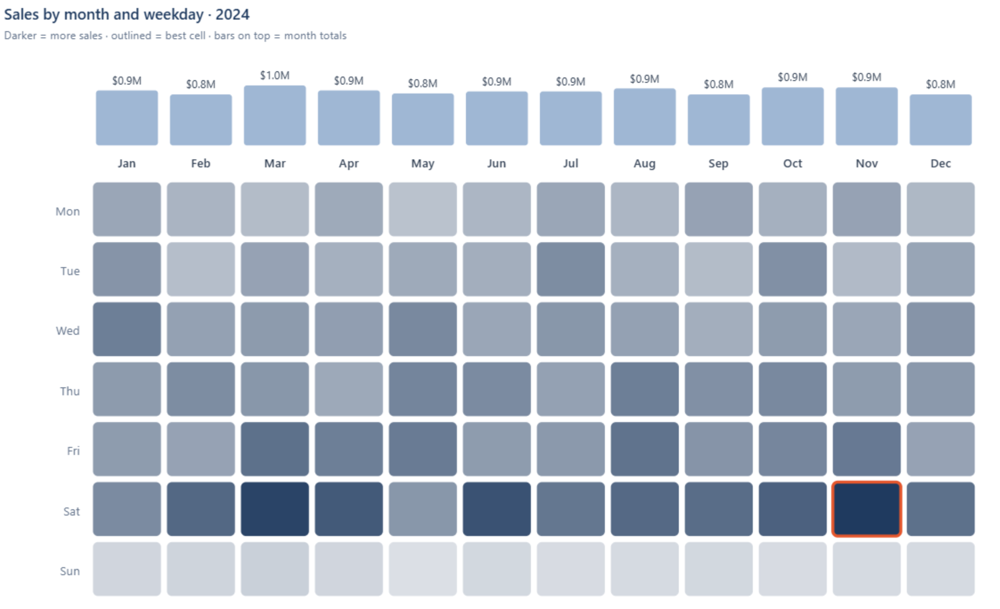

# Calendario de ventas: qué meses y días de la semana venden más

Una cuadrícula mes × día de la semana en **HTML Content** para Power BI: cuanto más oscura la celda, más ventas; la mejor celda va recuadrada y encima de cada mes una barra con su total.

Ficha y vista previa: <https://csalcedodatabi.com/recursos/galeria-html/calendario-ventas>



---

## Abre y pinta

El informe usa **Contoso-Retail** (2023–2024), el modelo maestro de la galería, con los datos de [SampleDataSets](https://github.com/CSalcedoDataBI/SampleDataSets) (MIT) leídos por internet. Descomprimes, abres `pbip/Calendario_Ventas.pbip` en Power BI Desktop, pulsas **Actualizar** la primera vez y el visual está en la página **«Calendario de ventas»**, filtrada al año 2024.

```
Calendario_Ventas/
├── pbip/                    el informe + su modelo, en texto
├── calendario-ventas.dax    la medida HTML, para copiar
└── Calendario_Ventas.zip    todo lo anterior
```

## Cómo lo conecto a MIS datos

1. Copia la medida `HTML Calendar Month Weekday` de `calendario-ventas.dax`.
2. Cambia tres nombres por los tuyos: el número de mes (`'DimDate'[Month]`, de 1 a 12), el día de la semana (`'DimDate'[DayOfWeek]`, 0 = lunes) con su nombre (`'DimDate'[DayName]`), y tu medida de ventas (`[Total Sales]`).
3. Ponla en un visual **HTML Content** y filtra un año en la página.

## Licencia

MIT — ver [LICENSE](../LICENSE). Hecho por [CSalcedoDataBI](https://csalcedodatabi.com).
