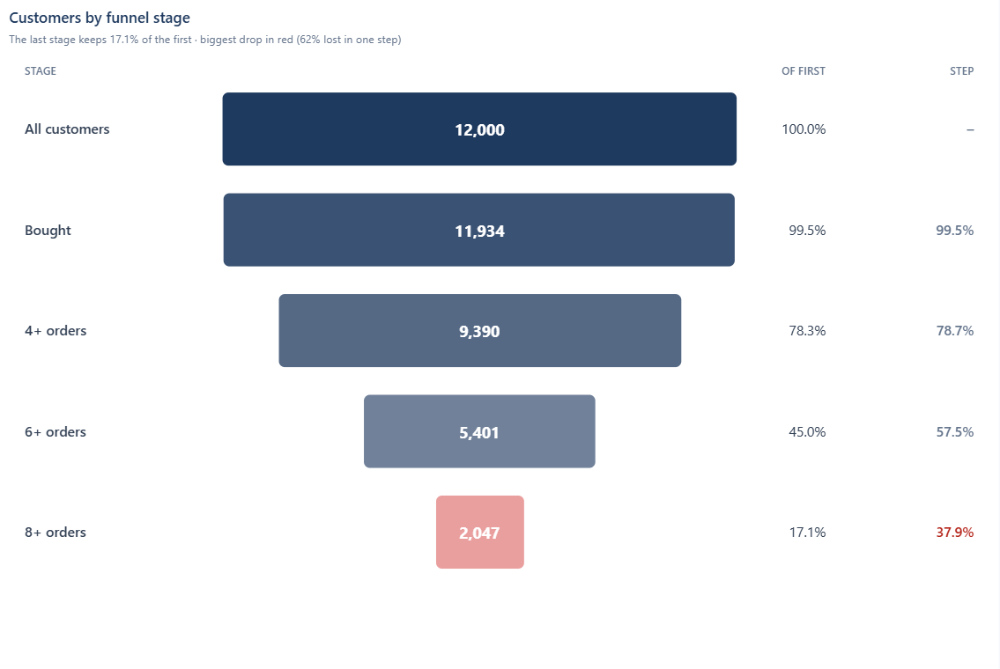

# Embudo de clientes — dónde se pierden los clientes

Un embudo en **HTML Content** para Power BI: de todos los clientes registrados a los que compraron
y a los que volvieron 4, 6 y 8 o más veces. Cada etapa dice cuántos clientes quedan, qué parte del
primero conserva y la conversión del paso; **la caída más grande sale en rojo** y el subtítulo la
cuenta en una frase.

Ficha y vista previa: <https://csalcedodatabi.com/recursos/galeria-html/embudo-clientes>



---

## Abre y pinta

El informe usa **Contoso-Retail** (2023–2024), el modelo maestro de la galería, con los datos de
[SampleDataSets](https://github.com/CSalcedoDataBI/SampleDataSets) (MIT) leídos por internet. Descomprimes, abres `pbip/Embudo_Clientes.pbip` en Power BI Desktop,
pulsas **Actualizar** la primera vez y el visual está en la página **«Embudo de clientes»**,
filtrada al año 2024.

```
Embudo_Clientes/
├── pbip/                  el informe + su modelo, en texto
├── embudo-clientes.dax    la tabla de etapas y las dos medidas, para copiar
└── Embudo_Clientes.zip    todo lo anterior
```

## Cómo lo conecto a MIS datos

1. Crea la tabla desconectada `Funnel Stage` (está en `embudo-clientes.dax`) y cambia las etapas:
   `MinOrders = -1` es «todos los clientes», `1` es «compró» y desde ahí, «N o más pedidos».
2. Copia la medida `Funnel Customers` y cambia tres nombres por los tuyos: la tabla de clientes
   (`DimCustomer`), el recuento de compradores (`[Distinct Customers]`) y la clave de pedido
   (`FactSales[OrderKey]`).
3. Copia `HTML Funnel Customers` tal cual y ponla en un visual **HTML Content**. Nada más.

El visual responde a los filtros de la página: filtra un año, un canal o una tienda y el embudo
se recalcula.

## Licencia

MIT — ver [LICENSE](../LICENSE). Hecho por [CSalcedoDataBI](https://csalcedodatabi.com).
