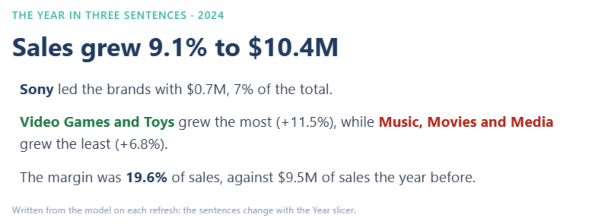

# Narrativa del año

El año contado en tres frases, en **HTML Content** para Power BI: cuánto crecieron las ventas, qué marca lideró, qué categoría creció más y cuál menos, y el margen. Se escribe solo desde el modelo y cambia con el filtro de año.

Ficha y vista previa: <https://csalcedodatabi.com/recursos/galeria-html/narrativa-anual>



---

## Abre y pinta

El informe usa **Contoso-Retail** (2023–2024), el modelo maestro de la galería, con los datos de [SampleDataSets](https://github.com/CSalcedoDataBI/SampleDataSets) (MIT) leídos por internet. Descomprimes, abres `pbip/Narrativa_Anual.pbip` en Power BI Desktop, pulsas **Actualizar** la primera vez y el visual está en la página **«Narrativa del año»**, filtrada al año 2024.

```
Narrativa_Anual/
├── pbip/          el informe + su modelo, en texto
├── narrativa-anual.dax      la medida HTML, para copiar
└── Narrativa_Anual.zip      todo lo anterior
```

## Cómo lo conecto a MIS datos

1. Copia la medida `HTML Insight Narrative` de `narrativa-anual.dax`.
2. Cambia `[Total Sales]`, `[Sales PY]` y `[Margin %]` por tus medidas, y `'DimProduct'[Brand]` y `'DimProduct'[CategoryName]` por tus columnas de marca y categoría.
3. Ponla en un visual **HTML Content** y filtra un año en la página.

## Licencia

MIT — ver [LICENSE](../LICENSE). Hecho por [CSalcedoDataBI](https://csalcedodatabi.com).
