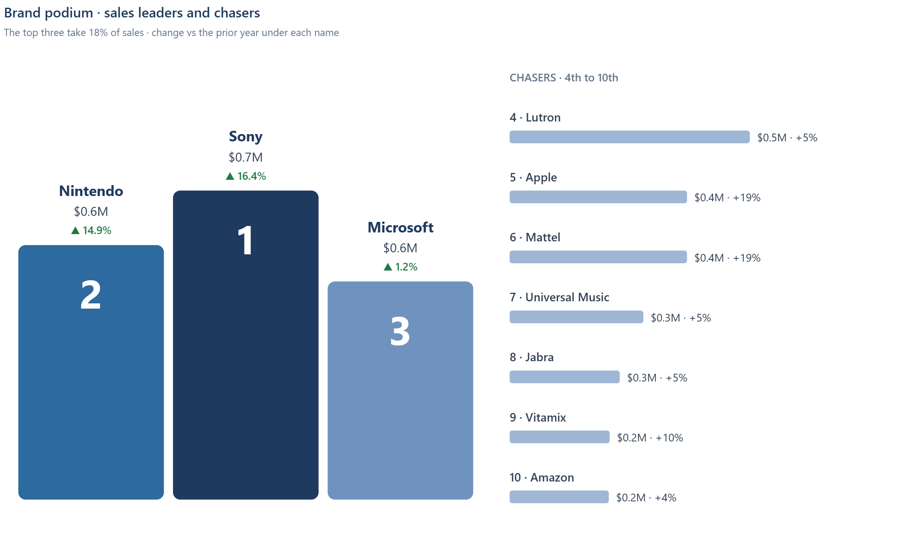

# Podio de marcas

Un podio en **HTML Content** para Power BI: las tres marcas que más venden en su escalón, con sus ventas y el cambio frente al año anterior, y a la derecha las perseguidoras del 4.º al 10.º puesto.

Ficha y vista previa: <https://csalcedodatabi.com/recursos/galeria-html/podio-marcas>



---

## Abre y pinta

El informe usa **Contoso-Retail** (2023–2024), el modelo maestro de la galería, con los datos de [SampleDataSets](https://github.com/CSalcedoDataBI/SampleDataSets) (MIT) leídos por internet. Descomprimes, abres `pbip/Podio_Marcas.pbip` en Power BI Desktop, pulsas **Actualizar** la primera vez y el visual está en la página **«Podio de marcas»**, filtrada al año 2024.

```
Podio_Marcas/
├── pbip/          el informe + su modelo, en texto
├── podio-marcas.dax      la medida HTML, para copiar
└── Podio_Marcas.zip      todo lo anterior
```

## Cómo lo conecto a MIS datos

1. Copia la medida `HTML Podium Brand` de `podio-marcas.dax`.
2. Cambia `'DimProduct'[Brand]` por tu columna de marca, y `[Total Sales]` y `[Sales PY]` por tus medidas de ventas y de ventas del año anterior.
3. Ponla en un visual **HTML Content** y filtra un año en la página.

## Licencia

MIT — ver [LICENSE](../LICENSE). Hecho por [CSalcedoDataBI](https://csalcedodatabi.com).
