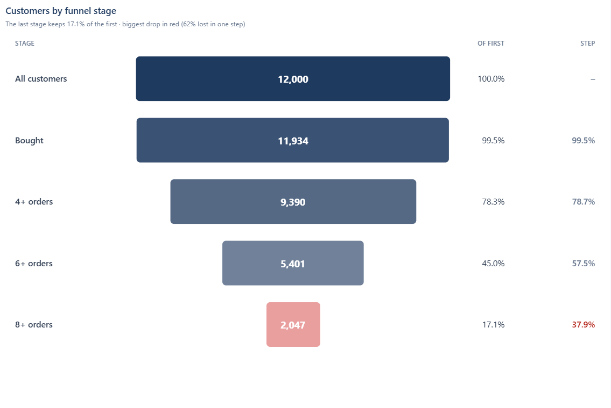

# PowerBI-HTML | Visuales HTML Content para Power BI

[](LICENSE)
[](https://www.youtube.com/@CSalcedoDataBI)

Plantillas para el visual **HTML Content** de Power BI: una medida DAX que devuelve HTML y CSS,
lista para copiar en tu modelo. Hermano de [PowerBI-Deneb](https://github.com/CSalcedoDataBI/PowerBI-Deneb).

Galería con vista previa: <https://csalcedodatabi.com/recursos/galeria-html/>

## Qué trae cada carpeta

```
Nombre_Del_Visual/
├── README.md              qué responde, qué campos necesita, cómo conectarlo a tus datos
├── pbip/Contoso-Retail.*  el informe sobre el maestro Contoso-Retail (2023–2024), en texto
├── <visual>.dax           la medida HTML suelta, para copiar
└── Nombre_Del_Visual.zip  todo lo anterior
```

## Cómo se usa

1. Descarga el `.zip` de la carpeta y descomprímelo.
2. Abre `pbip/Contoso-Retail.pbip` en Power BI Desktop y pulsa **Actualizar** la primera vez (lee los datos de SampleDataSets).
3. El visual está en su página; el README de la carpeta dice qué medida copiar y qué campos cambiar.

## Visuales

Haz clic en una imagen para abrir su carpeta: README, medida DAX y PBIP.

| | |
|:---:|:---:|
| [](Embudo_Clientes/)<br>**[Embudo de clientes](Embudo_Clientes/)**<br>¿Dónde se pierden los clientes? | |

## Licencia

MIT. Úsalo, cámbialo y compártelo; se agradece la mención.

---

<div align="center">

[](https://csalcedodatabi.com)
[](https://csalcedodatabi.com/blog/)
[](https://csalcedodatabi.com/recursos/galeria-html/)
[](https://csalcedodatabi.com/deneb/)

[](https://www.linkedin.com/in/cristobal-salcedo)
[](https://www.youtube.com/@CSalcedoDataBI)
[](https://csalcedodatabi.com/contacto/)

</div>